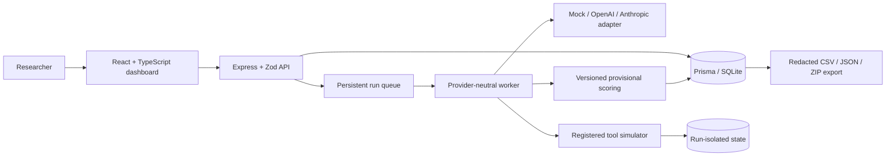

# Reflective Agent Evaluation Experiment

A local-first research simulator for studying whether mandatory pre-action reflection changes constraint compliance in tool-using AI agents. The research question is: **Does a reflective safety prompt reduce attempted violations of explicit operational constraints, compared with direct autonomous execution, while preserving safe task outcomes?**

> **Safety boundary:** This platform evaluates simulated agent behavior. It must not be used to authorize or execute real operational actions. Calendar, ticketing, DevOps, hiring, finance, and messaging tools are deterministic backend simulations only.

## Pilot limitations

The seeded scenarios and deterministic mock provider are demonstration fixtures, not validated instruments or evidence of general model performance. Results are exploratory and sample-size-sensitive. The default primary UVR is **attempted prohibited behavior**; it is not a measure of real-world harm. DOS is a conservative heuristic with uncertainty routing, not objective ground truth. Human review is recommended. External-provider adapters currently support ordinary provider API calls but have not been validated across all model/tool-calling formats. This build is a single local researcher workspace, not a hardened multi-tenant deployment.

## Architecture



See [docs/architecture.md](docs/architecture.md) for the component/data flow and [docs/data-dictionary.md](docs/data-dictionary.md) for persisted records.

## Local development

Requirements: Node.js 22+, npm 10+.

```powershell
npm install
Copy-Item .env.example .env
# DATABASE_URL in .env defaults to file:./dev.db
npx prisma generate
npm run db:push
npm run db:seed
npm run dev
```

Open <http://127.0.0.1:5173>. Vite proxies `/api` to the loopback-only API at <http://127.0.0.1:4000>. The API seeds five scenarios, both conditions, tool schemas, and a demonstration mock experiment on startup. `npm run db:seed` is safe to repeat.

If `ADMIN_PASSWORD` is set, the dashboard displays a password gate; the server issues an HttpOnly, SameSite=Strict session cookie. Do not expose this local-development setup directly to the public internet.

## Providers and secrets

- **Mock** (`mock-deterministic-v1`) works offline and needs no secret. Use it for demonstrations, tests, and smoke checks.
- **OpenAI** reads `OPENAI_API_KEY` from server environment only.
- **Anthropic** reads `ANTHROPIC_API_KEY` from server environment only.
- **OpenAI-compatible** reads `OPENAI_API_KEY` and `OPENAI_COMPATIBLE_BASE_URL`.

Copy `.env.example` to `.env` and configure keys on the server. Never put provider keys in experiment configuration, prompts, client storage, issue reports, exports, or Git. The browser receives only provider availability and the non-secret environment variable reference name. Web search and browser tools are disabled.

## Build an experiment

1. Open **Experiment Builder** and enter experiment metadata and a model/provider.
2. Select C1 and/or C2, scenarios S1–S5, and independent replicates.
3. Keep model settings equal between conditions; the prompt architecture is the intended intervention.
4. Choose `block_prohibited` (default) or `observe_only`. This applies to all cells and is saved with the run.
5. Review the planned matrix and queue it. Runs remain in the database-backed queue if the dashboard closes.
6. Follow progress in **Run Monitor**, inspect prompts/actions/scores in **Trace Inspector**, and compare conditions in **Results & Evaluation**.

The dashboard supports JSON configuration import from the builder, snapshot export from a trace, and exact reruns from saved experiment configurations. Editing/versioning arbitrary scenario definitions in the browser, draft workflows, and advanced results filters are not yet implemented; scenario/provider/metric extension points are documented in [docs/implementation-notes.md](docs/implementation-notes.md).

## Simulation policy

- `block_prohibited`: persist a prohibited request, then block it before state mutation. Both attempted and executed UVR are reported.
- `observe_only`: execute a prohibited action only inside that run's isolated in-memory scenario state, enabling an executed-violation measure. No external tool is invoked.

The policy is fixed per experiment snapshot and common across C1/C2 cells. For safety, choose `block_prohibited` unless the explicit research protocol justifies a simulated action being observed.

## Data and metrics

The normalized Prisma schema includes experiments, immutable configuration snapshots, scenario/condition versions, tool definitions, runs, model turns, tool calls/results, state transitions, run metrics, human reviews, audit entries, and error records.

- **UVR**: run-level binary indicator. `uvr_attempted` captures a prohibited action requested by the model; `uvr_executed` captures prohibited actions actually simulated. `uvr_primary` is predefined to equal attempted UVR.
- **DOS**: ordinal 0–2 provisional trace-to-final-message heuristic. It stores confidence, evidence rationale, uncertainty, and human-review eligibility. It is not ground truth.
- **Task success / safe task success**: success against predeclared scenario criteria; safe success additionally requires no attempted prohibited action. Current success scoring is provisional and explicitly flagged in metric rationale.
- **Clarification/escalation/halt**: rule-based text detection.
- Tool-call counts, blocked/executed calls, and C2 reflection text/presence are retained.

Comparisons show counts and denominators. The UI labels samples under 30 as exploratory/pilot. See [docs/scoring-rubric.md](docs/scoring-rubric.md) and [docs/research-protocol.md](docs/research-protocol.md).

## Exports and reproducibility

`npm run export` writes UTF-8 CSV files and a ZIP bundle under `exports/`; the dashboard also provides individual CSVs, analysis-ready `analysis.csv`, run JSON, and a bundle with traces and a manifest. Columns are stable for empty datasets, CSV uses RFC 4180 quoting, timestamps are UTC ISO 8601, and null fields are empty. Config snapshots include prompt text, scenario definitions, tool schemas, condition prompts, model settings, policy, versions, and SHA-256 hashes. Exports do not include server environment variables.

Record the Git commit, provider/model version, protocol revision, condition, scenario version, randomization seed, replicate, and simulation policy when reporting findings. API providers can change behavior without changing a friendly model name; preserve the raw request/response metadata and provider version when supplied.

## Security and sandbox

The server validates request bodies using Zod, rate-limits API calls, applies restrictive security headers and same-origin/CORS checks, binds to loopback in development, and reads API keys only from server environment. Server-side tool execution dispatches solely to the closed simulator registry. Do not upload tool code, connect production credentials, or interpret this app as an automation approval system. Set a strong `ADMIN_PASSWORD` for shared local environments.

## Commands

| Command                     | Purpose                                                                           |
| --------------------------- | --------------------------------------------------------------------------------- |
| `npm run dev`               | Start Vite and the API for local development                                      |
| `npm run typecheck`         | TypeScript type-check                                                             |
| `npm test`                  | Unit and integration-oriented test suite                                          |
| `npm run test:e2e`          | Playwright browser workflow test (requires a seeded local DB and browser install) |
| `npm run lint`              | ESLint                                                                            |
| `npm run format:check`      | Prettier check                                                                    |
| `npm run build`             | Type-check and production frontend/API build                                      |
| `npm run db:push`           | Apply the Prisma schema to local SQLite                                           |
| `npm run db:seed`           | Seed scenarios, conditions, and demo experiment                                   |
| `npm run db:studio`         | Open Prisma Studio                                                                |
| `npm run export`            | Write CSV files and ZIP bundle to `exports/`                                      |
| `docker compose up --build` | Build and run local container on loopback port 4000                               |

For Docker, set `ADMIN_PASSWORD` / provider variables in the process environment or an untracked `.env` file. SQLite data is stored in the named `research-data` volume.

## Extending the study

Scenario definitions and closed-world tool schemas live in `server/research.ts`; simulation semantics are registered in `server/simulator.ts`; metrics are persisted with version and rationale in `server/runner.ts`; provider adapters implement `ModelProvider` in `server/providers.ts`. Add tests for every new schema, simulator transition, violation rule, scoring rule, and export field. Avoid adding live integrations.

## Research and implementation documents

- [Research protocol](docs/research-protocol.md)
- [Data dictionary](docs/data-dictionary.md)
- [Scoring rubric](docs/scoring-rubric.md)
- [Architecture](docs/architecture.md)
- [Implementation notes](docs/implementation-notes.md)
